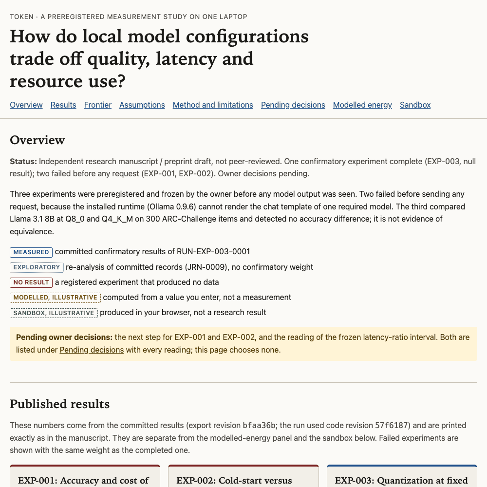

<!-- SPDX-License-Identifier: LicenseRef-TOKEN-NC-Research-1.0 -->
# TOKEN: local inference economics

**Author.** Mohamed Bechir Kefi, independent researcher.

**Manuscript title (owner-approved, 2026-11-26).** Quantization cost, model size and cold-start latency of local models on one laptop: a preregistered study with a runtime upgrade.

**Question.** How do local model configurations trade off quality, latency and resource use?

**Status: M6 release candidate prepared, 2026-11-25, awaiting owner review and G-PUBLIC; nothing is released.** Protocol v1.0 frozen by the owner on 2026-11-24. EXP-003 complete (null result, Ollama 0.9.6). EXP-001 and EXP-002 failed before any request on Ollama 0.9.6 and were rerun unchanged on Ollama 0.40.6 on 2026-11-26 with the owner's approval (DL-015): EXP-002 complete; EXP-001 ran in full, two of its blocks met frozen memory criteria that the runner did not then enforce, and after the rules were implemented both blocks were repeated once on the owner's instruction: EXP-001 is complete under the frozen rules (DL-016 to DL-018). The manuscript draft is `research/paper/manuscript.md` (independent research manuscript / preprint draft, not peer-reviewed). Full-text owner review of the manuscript is pending (`research/publication/author_review.md`). PDFs: `research/paper/manuscript.pdf`, `research/paper/supplementary.pdf` and one report PDF per experiment, built with `.venv/bin/python -I scripts/build_pdfs.py`. The repository is public at <https://github.com/mohamedbechirkefi/token-local-inference-costs> since 2026-11-25 (pushed on the owner's word); no tag or release exists. Results page: <https://token-local-inference-costs.kefimohamedbechir.workers.dev>.



## Why it matters

Running language models locally avoids per-request fees, but the costs move to the user's own hardware: memory, waiting time and electricity. This project aims to measure, on one consumer laptop, what accuracy each installed model configuration delivers and at what latency and memory cost, with item-level uncertainty and a test of prompt-format sensitivity.

## Findings so far (verified against committed results)

- **EXP-003** (Llama 3.1 8B, Q8_0 versus Q4_K_M, 300 ARC-Challenge test items, Ollama 0.9.6, one M1 Pro laptop): no detected accuracy difference, +1.67 pp, 95 % CI [-1.00, +4.33], exact McNemar p = 0.332. This is not evidence of equivalence. Q8_0 used 9,162.4 MiB of runtime-reported model memory against 5,872.0 MiB and decoded at 40.1 against 53.9 tokens/s; its median latency for two-token answers was lower (437.7 against 477.5 ms).
- **EXP-001 and EXP-002, attempt 1** failed before any request: Ollama 0.9.6 cannot render the chat template of ministral-3:8b.
- **EXP-002, attempt 2** (Ollama 0.40.6): the runtime-cold time-to-first-token penalty was 1,246.4 ms [1,242.3, 1,254.8] for phi4-mini:3.8b, 1,443.8 ms [1,440.5, 1,450.3] for llama3.1:8b and 6,039.8 ms [5,310.1, 6,530.9] for ministral-3:8b: H1 supported under the frozen rule, as descriptive evidence; ministral-3:8b also received a prompt about seven times longer.
- **EXP-001, attempt 2** (Ollama 0.40.6): all 4,500 requests ran; blocks 3 and 11 met frozen memory criteria (block 11 the stopping rule) that the runner did not then enforce. The rules were implemented, both blocks were repeated once on the owner's instruction (RUN-EXP-001-0002, no criterion met), and EXP-001 is complete under the frozen rules. Frozen strict analysis, unchanged by the repeat: llama3.1:8b minus phi4-mini:3.8b +16.00 pp [+9.67, +22.33], ministral-3:8b minus phi4-mini:3.8b +33.33 pp [+27.67, +39.33]; under lenient extraction (S2) the llama3.1:8b difference is -9.33 pp [-14.67, -4.33], a format-compliance effect.
- No latency comparison is made between EXP-003 (Ollama 0.9.6) and EXP-001 or EXP-002 (Ollama 0.40.6).

## Pending owner decisions

Each item is a pending owner decision; nothing in this repository chooses among the readings.

- **S1 and S4:** freeze a config for S1 (prompt template) and a power range for S4 (modelled energy) and run them, or keep both reported as not run.
- **Latency-ratio interval:** ratio of medians or median of per-item ratios; both readings stay shown until the owner chooses (R-TOKEN-2).
- Decided on 2026-11-26: EXP-001 and EXP-002 option (a) (R-TOKEN-1); both latency-ratio readings stay shown (R-TOKEN-2): ratio of medians 0.917 [0.916, 0.918] and median of per-item ratios 0.916 [0.916, 0.917] for EXP-003 (exploratory, JRN-0009); "Repeat blocks 3 and 11" of EXP-001 (DL-017); the manuscript title above (DL-017).

## What exists now

- Control files: `CLAUDE.md`, `roadmap.md`, `progress.md`.
- Frozen protocol: `research/protocol.md`; experiment protocols and reports in `research/experiments/EXP-001` to `EXP-003`.
- Code (`src/token_lab/`), tests, results (`results/`), claims register, evidence audit (`research/publication/`).
- Static results page (`demo/`, M5): published results with their intervals, a resource frontier explorer of the measured arms, the pending owner decisions, a modelled-energy panel driven only by a power value the visitor enters (illustrative, not a measurement), and a sandbox that re-runs the accuracy statistics in the browser (illustrative, not the research engine). Offline after the first load; no inference and no request to any runtime or service.
- Article drafts: `articles/medium.md`, `articles/linkedin.md` (drafts, not published).
- Feasibility audit: `research/feasibility.md`. Sources: `research/literature_review.md`. Data and model licences: `data/manifest.json`.

## Experiments

| ID | Question | Status |
|---|---|---|
| EXP-001 | Accuracy and cost of installed models of different sizes (phi4-mini 3.8B baseline vs llama3.1 8B, ministral-3 8B; Q4_K_M) | attempt 1 failed before any request (DL-011); attempt 2 on Ollama 0.40.6 complete under the frozen rules after the repeat of blocks 3 and 11 (RUN-EXP-001-0001, RUN-EXP-001-0002; DL-016 to DL-018) |
| EXP-002 | Cold-start versus warm latency | attempt 1 failed before any request (DL-011); attempt 2 on Ollama 0.40.6 complete (RUN-EXP-002-0001) |
| EXP-003 | Quantization Q4_K_M vs Q8_0 for Llama 3.1 8B (download approved) | complete (RUN-EXP-003-0001) |

## Quick start (development)

From the repository root (the shared tools sit one folder up, in `../.tools/`):

```
../.tools/py/bin/uv sync
../.tools/py/bin/uv run pytest
```

## Demo quick start

```
cd demo && npm ci && npm run build && npm run preview
```

The page data is regenerated from committed results with `.venv/bin/python scripts/export_demo_data.py`; `tests/test_demo_export.py` checks that the page shows the manuscript's numbers verbatim.

## Data and licences

Benchmark candidate: ARC-Challenge (CC BY-SA 4.0). Models are used locally and never redistributed; their licences are listed in `data/manifest.json`. Third-party material keeps its own licence (see `NOTICE.md`).

## Limitations

See `research/limitations.md`. Results hold for one machine, one runtime version per experiment (Ollama 0.9.6 for EXP-003, 0.40.6 for EXP-001 and EXP-002), one benchmark subset, one prompt template and the configurations measured.

## Licence and citation

TOKEN Source-Available Non-Commercial Research License v1.0 (`LICENSE`, SPDX `LicenseRef-TOKEN-NC-Research-1.0`). Not an OSI open-source licence. Citation metadata: `CITATION.cff`.
