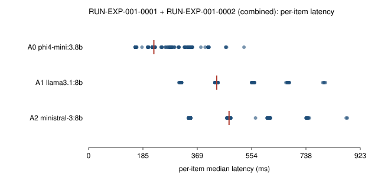

<!-- SPDX-License-Identifier: LicenseRef-TOKEN-NC-Research-1.0 -->
# EXP-001 report: accuracy and cost of installed local models of different sizes

**Status: CONFIRMATORY, two attempts.**

- **Attempt 1 (2026-11-25, Ollama 0.9.6): FAILED before any request. No results.** Kept unchanged in the section "Attempt 1" at the end of this report.
- **Attempt 2 (2026-11-26, Ollama 0.40.6, owner option a): matrix complete (4,500 of 4,500 requests, 0 errors), but a frozen stopping criterion was met after the fact.** Block 11 of 15 had swap growth above 2 GiB and blocks 3 and 11 above 512 MiB. The runner enforces neither rule, so the run did not stop and no block was repeated. Under the stopping rule as written the experiment is a failure; the frozen analysis of the complete matrix is reported below with that status, and **whether it counts as confirmatory is the owner's decision** (DL-016).

## 1. Identification

- Experiment: EXP-001. Run: RUN-EXP-001-0001. Date: 2026-11-26. Protocol v1.0, frozen 2026-11-24 (owner, G-FREEZE), SHA-256 1997317c931cf95d04c271ab2414aef82306f5976f1eea7262eb1e4d54fee8e4; main protocol ea86d0bb2d1864f69ac545bde1c8dd263276c8dbd9d1b3fee5b7a49b8dd4d2c3.
- Config `experiments/EXP-001.json`, canonical SHA-256 355d86f1cd3bc28373bef6e3e36c32828337583b0893d2b87d4c33fa48c7913e (unchanged).
- Code revision ca3a08fb536fbb80196354b5bdc0b3c26b38aa56, clean tree (`dirty: false`). Authorship: Mohamed Bechir Kefi (C3); the AI was used as a research and development assistant.
- **Dated deviation (owner-approved): runtime version 0.9.6 -> 0.40.6, owner option a** (owner, 2026-11-26, R-TOKEN-1: "upgrade Ollama and run the frozen EXP-001 and EXP-002 matrices unchanged, runtime version recorded"; DL-015). Nothing else changed.

## 2. Executive summary

- Question: do llama3.1:8b (A1) or ministral-3:8b (A2) differ in accuracy from phi4-mini:3.8b (A0) on a fixed 300-item ARC-Challenge subset, and at what cost?
- Frozen primary analysis (strict extraction, Holm over two contrasts): A1 minus A0 = +16.00 pp, 95 % CI [+9.67, +22.33], Holm p = 2.1e-06; A2 minus A0 = +33.33 pp [+27.67, +39.33], Holm p = 3.3e-23. By the decision rule, H0 is rejected for both arms.
- Frozen sensitivity S2 (lenient extraction): A1 minus A0 = -9.33 pp [-14.67, -4.33]; A2 minus A0 = +8.33 pp [+4.00, +12.67]. The A1 sign reverses: A0 often wrote the label followed by text (520 of 1,500 records), so by the frozen S2 text the strict A1 advantage reflects format compliance, not knowledge. A2 leads A0 under both rules.
- Cost: both larger arms were about twice as slow per item as A0 (median 434.8 and 476.8 against 221.6 ms) and used 4,777.5 and 5,113.6 against 2,698.6 MiB of runtime-reported model memory.
- Principal caveats: the stopping-criterion status above; on 0.40.6, A2's prompts are about seven times longer than A0's and A1's; EXP-003 ran on a different runtime version (0.9.6), so no latency comparison with EXP-003 is made.

## 3. Rationale

As in the frozen protocol, items 2 and 3: larger parameter counts may raise multiple-choice accuracy, while bytes read per generated token grow with model size. dettmers2022kbit and llamacpp-quantize are the verified sources; neither gives a paired, item-level accuracy-plus-cost measurement for these installed configurations on a laptop.

## 4. Hypotheses

Unchanged. H0_k: Delta_k = 0 against H1_k: Delta_k != 0, for k in {A1, A2}, with Holm correction over the two contrasts (family-wise alpha 0.05). Contradiction for an arm: the 95 % paired bootstrap CI contains 0 and the Holm-adjusted exact McNemar test does not reject; reported as no detected difference, not equivalence.

## 5. Methodology (as frozen)

- Data: ARC-Challenge test (CC BY-SA 4.0), Hugging Face `allenai/ai2_arc` at revision 210d026f, JSONL SHA-256 86ccaace...1f63; 300 items drawn with seed 20261124 (`data/arc_challenge_test_subset_ids.json`).
- Arms: A0 phi4-mini:3.8b, A1 llama3.1:8b, A2 ministral-3:8b, all GGUF Q4_K_M, from the local store; no model was pulled. Each weights blob was re-hashed and matched its content digest (A0 sha256-3c168af1..., A1 sha256-667b0c19..., A2 sha256-3ea32f88...; manifest digests 78fad5d1..., 46e0c10c..., 1922accd...).
- Template T1, temperature 0, num_predict 8, num_ctx 2048, runtime seeds 0 to 4, item and arm order from seed 1000 + repetition, one discarded warm-up per block, at most 2 retries.
- Statistics: paired bootstrap over items (10,000 resamples, seed 7, percentile intervals), exact McNemar on majority correctness, Holm over the two contrasts within each extraction rule.
- Hardware and software: Apple M1 Pro (10 cores), 16 GB, macOS 15.3.1, AC power, Low Power Mode off. Ollama 0.40.6 (official darwin build; tarball SHA-256 b2b55434...f974, binary `labs/.tools/ollama-0.40.6/ollama` SHA-256 69fcb23a...c2ff), started by the rerun session on 127.0.0.1:11434 with no other client. Python 3.12.1, numpy 2.3.4, psutil 7.1.0, jsonschema 4.25.1.
- Budget: 4,500 requests, 4-hour cap, zero cost.

## 6. Implementation verification

- Before the run: full suite 162 passed; every frozen hash (protocols, configs, item IDs, item files) matched; the runner checked the item file and the subset IDs before the first request.
- The guard does not include the runtime version in the frozen fingerprint; nothing refused the run on that ground.
- `/api/show` on 0.40.6: A0 and A1 template, parameter and Modelfile hashes equal those recorded on 0.9.6; A2 now describes (template 5b74c26b..., parameters e96fd3ce..., Modelfile bfc40cd3...).
- Exploratory smoke on the new runtime, RUN-SMOKE-0007 (JRN-0010): 10 validation items x 3 arms x 2 repetitions, 60 requests, 0 failures, determinism 1.00, TTFT not above latency on any record. It found that peak RSS no longer covers the runner process (limitation 27).

## 7. Execution record

- Command: `nice -n 5 .venv/bin/token-lab run --config experiments/EXP-001.json`, then `token-lab report --result results/confirmatory/RUN-EXP-001-0001/result.json`.
- Start 2026-11-26T12:31:06Z, end 13:01:55Z, 1,849.1 s, exit 0.
- Quiet-machine readings (rule: the protocol's controls plus the M3 practice of a 1-minute load below 2.5 and an empty `/api/ps`; DL-015):
  - Waiting: 12:23:44Z load 3.57; 12:24:36Z 3.12; 12:26:42Z 2.95; 12:28:43Z 2.48 with the smoke models still loaded; 12:29:05Z 3.11; 12:30:05Z 2.15.
  - Start: load average 1.68 / 2.55 / 2.78, AC power, Low Power Mode off, no model loaded, swap used 4,505.56 MiB.
  - End: load 1.49 / 1.04 / 1.18, swap used 5,833.94 MiB.
- Counts: 15 blocks, 4,500 records, 0 request errors, 0 retries needed.
- Block check against the frozen criteria (main protocol section 9), from the block records after the run, because the runner does not implement them (DL-011 gap 2), in the table below.

| Block | Arm, repetition | Swap growth (MiB) | Criterion met |
|---|---|---|---|
| 3 | A1, 0 | 734.1 | exclusion (above 512 MiB): block to be excluded and repeated once |
| 11 | A0, 3 | 2,778.1 | exclusion, and stopping rule (above 2 GiB): "abort ...; report as a failure" |
| other 13 | | at most 0.0 | none |

- No foreign model was listed before or after any block; the machine was on AC power at start and end (power is not recorded per block); one runtime version served the whole run.
- Consequence: the run did not stop and neither block was repeated. Accuracy was identical in all five repetitions of every arm (JRN-0013), so no accuracy value depends on blocks 3 and 11; their timing and memory readings were taken under memory pressure. The status is for the owner (DL-016).

## 8. Results

Analysis exactly as frozen, computed by `token-lab report` on the complete matrix, with the status of section 7.

| Arm | Accuracy strict | Accuracy lenient | Strict format failures (records of 1,500) | Median latency [Q1, Q3] (ms) | TTFT median (ms) | Decode (tok/s) | Runtime model memory (MiB) | Median prompt length (tokens) | Determinism |
|---|---|---|---|---|---|---|---|---|---|
| A0 phi4-mini:3.8b | 0.560 | 0.813 | 520 | 221.6 [218.2, 307.7] | 195.2 | 88.6 | 2,698.6 | 84 | 1.00 |
| A1 llama3.1:8b | 0.720 | 0.720 | 10 | 434.8 [430.9, 555.2] | 393.6 | 49.1 | 4,777.5 | 91.5 | 1.00 |
| A2 ministral-3:8b | 0.893 | 0.897 | 5 | 476.8 [470.9, 606.9] | 430.4 | 45.7 | 5,113.6 | 636 | 1.00 |

| Contrast | Extraction | n | Delta (pp) | 95 % CI (pp) | b | c | McNemar p | Holm p |
|---|---|---|---|---|---|---|---|---|
| A1 vs A0 | strict (primary) | 300 | +16.00 | [+9.67, +22.33] | 75 | 27 | 2.1e-06 | 2.1e-06 |
| A2 vs A0 | strict (primary) | 300 | +33.33 | [+27.67, +39.33] | 108 | 8 | 1.6e-23 | 3.3e-23 |
| A1 vs A0 | lenient (S2) | 300 | -9.33 | [-14.67, -4.33] | 19 | 47 | 7.6e-04 | 7.6e-04 |
| A2 vs A0 | lenient (S2) | 300 | +8.33 | [+4.00, +12.67] | 35 | 10 | 2.5e-04 | 4.9e-04 |

- Chance floor 0.251. Accuracy was identical in every repetition (A0 0.560, A1 0.720, A2 0.893, five times each).
- A0's strict failures are on 104 items; typical responses are "B. liquid" or "A. wind energy": the label followed by the option text, which strict extraction does not accept and lenient extraction does.
- Latency ratio to A0, both readings of protocol section 8 (owner R-TOKEN-2; exploratory, JRN-0013): A1/A0 1.962 [1.767, 1.968] (ratio of medians) and 1.977 [1.973, 1.980] (median of per-item ratios); A2/A0 2.151 [1.937, 2.157] and 2.162 [2.156, 2.166]. Both larger arms were slower than A0 on 300 of 300 items.
- S3 (descriptive): per-repetition median latency of A1 and A2 varied by less than 1 % (A1 434.5 to 435.9 ms, A2 476.3 to 477.0 ms). A0's repetition 2 block had a median latency of 50.1 ms against 221.7 to 223.8 ms in the others (see section 9), so its coefficient of variation across repetitions is 0.41; per-item medians over five repetitions are not affected by one fast repetition.
- Peak RSS (26.5 to 28.0 MiB per block) covers only the Ollama server process on 0.40.6 and is not reported as memory.
- Figure FIG-002 (`figures/FIG-002-exp001-latency.svg`): per-item median latency per arm. Each dot is one item (n = 300 per arm); the red bar is the median over items, in ms.

## 9. Interpretation

- **Expected versus observed.** The frozen H1 was nondirectional. Under strict extraction both 8B-class arms differed from the 3.8B baseline, in favour of the larger models. That is what the rationale suggests, but it is not what the frozen sensitivity analysis supports for A1.
- **Format compliance.** S2 is the frozen check for exactly this case. A0 knew the answer often enough to reach 0.813 under lenient extraction, above A1's 0.720, but it wrote the option text after the label in about a third of its records. The strict A1 advantage is therefore a difference in following the "label only" instruction, not in answering the questions. A2 is ahead of A0 under both rules, by 33.33 and 8.33 points, and ahead of A1 by inspection of the per-arm accuracies under both rules (no A2 versus A1 contrast was frozen, so none is tested).
- **Configurations, not size.** The arms differ in parameter count, architecture, training data, tokenizer and, on 0.40.6, prompt length: the ministral-3:8b template adds a default system text, so A2 received about 636 tokens per prompt against 84 and 91.5. A2's accuracy and latency belong to this configuration as rendered by this runtime.
- **Cost.** A1 and A2 took about twice A0's time per item and about 1.8 and 1.9 times its runtime-reported memory. Latency here is prefill-dominated (two-token answers); A2's higher latency includes its longer prompt.
- **Prompt reuse.** The A0 block of repetition 2 ran immediately after the A0 block of repetition 1, with the model still loaded, and its median prefill fell from about 191 to 22.0 ms. This is consistent with the runtime reusing processed prompts; it was not tested further.

## 10. Threats to validity

- **Stopping and exclusion criteria (internal).** Two blocks met frozen memory criteria that the runner does not enforce. Accuracy is unaffected (identical across repetitions); timings of those blocks were measured under memory pressure. Swap is system-wide: 4,505.56 MiB were in use at the start, and in block 11 the runtime kept ministral-3:8b loaded beside phi4-mini:3.8b.
- **Runtime (external).** One runtime version (0.40.6), different from EXP-003's (0.9.6). Prompt rendering by each model's own chat template is part of each arm; for A2 it includes a system text that depends on the run date (`currentDate`), so a rerun on another date sends a slightly different prompt.
- **Construct.** ARC-Challenge multiple-choice accuracy is a narrow proxy for quality; contamination is untested. Strict extraction measures instruction following as well as knowledge (S2).
- **Statistical.** The intervals are over items within one session; latency ratios are exploratory, both readings shown. S1 (template sensitivity) was not run.
- **Instrumentation.** Peak RSS does not include the runner process on 0.40.6; the named memory metric (`/api/ps`) is unaffected.

## 11. Conclusion and next step

If the owner counts the accuracy analysis as confirmatory: on this laptop with Ollama 0.40.6 and template T1, ministral-3:8b answered more ARC-Challenge items correctly than phi4-mini:3.8b under both extraction rules, while llama3.1:8b's strict advantage over phi4-mini:3.8b reverses under lenient extraction and is attributed to format compliance. Both 8B-class configurations cost about twice the latency and 1.8 to 1.9 times the runtime memory. Decisions for the owner:

- the status of EXP-001 under the stopping rule (failure as written, or the analysis counted with the disclosed criteria);
- whether blocks 3 and 11 are to be repeated (a further run needs the owner);
- implementing the exclusion and stopping rules in the runner before any further confirmatory run;
- S1 under a frozen config.

## 12. Reproduction appendix

- Environment: `../.tools/py/bin/uv sync --frozen --all-groups --all-extras`; tests `.venv/bin/python -m pytest`.
- Data: `/usr/local/bin/python3 -I scripts/fetch_arc.py --repo .` (expected JSONL SHA-256 86ccaace4cd159b5c02b6b3339ebe8a7022a54f1b488e433c060b3bc38ac1f63).
- Runtime: Ollama 0.40.6 official darwin build (`ollama-darwin.tgz`, SHA-256 b2b55434865a668decb494110d7fd970eed3ecc8837be2872f672ccbb95df974), `OLLAMA_HOST=127.0.0.1:11434 ollama serve`; models phi4-mini:3.8b, llama3.1:8b and ministral-3:8b at the digests in section 5.
- Run: `.venv/bin/token-lab run --config experiments/EXP-001.json` (AC power, no other client).
- Report and figure: `.venv/bin/token-lab report --result results/confirmatory/RUN-EXP-001-0001/result.json`. Exploratory checks: `.venv/bin/python -I scripts/rerun_exploratory_exp001.py --repo .` (`results/exploratory/RERUN-EXPL-0001/`).
- Raw outputs: `results/confirmatory/RUN-EXP-001-0001/` (result.json SHA-256 f95ee2055a9048559162cf8417a63f31682e5bf23dd724e0813b38e197cd003c; all hashes in `sha256_manifest.json`). Copies in this folder: `config.json`, `run_manifest.json`, `metrics.csv`, `contrasts.csv`, `figures/FIG-002-exp001-latency.svg`.
- Records: JRN-0010 to JRN-0013; DL-015, DL-016; claims CLM-016 to CLM-021, CLM-023 to CLM-025.

## Attempt 1 (2026-11-25, Ollama 0.9.6): FAILED before any request (kept as written)

**Label: CONFIRMATORY ATTEMPT, FAILED. No results exist from this attempt.** The text below is the report of the first attempt, unchanged except that its headings are one level lower. The owner's choice it asks for was made on 2026-11-26: option (a) (R-TOKEN-1; DL-015). The second attempt is reported above.

### 1. Identification

- Experiment: EXP-001. Date: 2026-11-25. Protocol v1.0, frozen 2026-11-24 (owner, G-FREEZE), SHA-256 1997317c931cf95d04c271ab2414aef82306f5976f1eea7262eb1e4d54fee8e4.
- Config canonical SHA-256 355d86f1cd3bc28373bef6e3e36c32828337583b0893d2b87d4c33fa48c7913e. Code revision 57f6187e7b450fea05eedbbee8c663943596a699.
- Authorship: Mohamed Bechir Kefi (C3); the AI was used as a research and development assistant.

### 2. Executive summary

- Question: do llama3.1:8b (A1) or ministral-3:8b (A2) differ in accuracy from phi4-mini:3.8b (A0) on a fixed 300-item ARC-Challenge subset, and at what cost?
- Outcome: the frozen run aborted before any generation request. The installed Ollama 0.9.6 cannot render the chat template of ministral-3:8b, which calls the function `currentDate`; this runtime does not define that function.
- No accuracy or cost result exists, and nothing about the hypotheses can be concluded.

### 3. Rationale

As in the frozen protocol, items 2 and 3. No result bears on it.

### 4. Hypotheses

Unchanged and untested. H0_k: Delta_k = 0 against H1_k: Delta_k != 0, for k in {A1, A2}, with Holm correction over the two contrasts.

### 5. Methodology (as frozen)

300 ARC-Challenge test items, three Q4_K_M arms, 5 repetitions (seeds 0 to 4), template T1, temperature 0, num_predict 8, num_ctx 2048. The planned matrix is 4,500 requests with a 4-hour cap.

### 6. Implementation verification

- Before the attempt: 144 tests passed, the frozen hashes matched, and the item checks passed.
- The exploratory smoke run RUN-SMOKE-0005 (JRN-0006) showed A0 and A1 working. Every A2 request, and `/api/show` for A2, returned HTTP 500 "template: :10: function currentDate not defined".

### 7. Execution record

- Command: `.venv/bin/token-lab run --config experiments/EXP-001.json`, at 2026-11-25T12:08:06Z.
- Machine state: load average 2.56 / 2.27 / 2.02, AC power. Ollama 0.9.6 was started by this session, with phi4-mini still loaded from the smoke run.
- What happened: the run passed the freeze guard and the item verification, then aborted at the per-arm `/api/show` fingerprint. Under amendment F8, a confirmatory run aborts if a model cannot be described.
- Output: exit 3, "backend error: HTTP 500 ... currentDate not defined". Generation requests sent: 0. No result file.
- Not retried: the cause is the runtime version, not a transient fault (JRN-0007, DL-011).

### 8. Results

None. The matrix was not executed: 0 of 4,500 planned requests.

### 9. Interpretation

The failure reflects runtime compatibility, not the models' quality. M0 could not detect it because the server was not running at that time. The installed model files were apparently pulled with a newer Ollama than the binary present on the machine; this is an inference, not verified.

### 10. Threats to validity

Not applicable to results. A rerun on another runtime version would change a recorded condition of the study (runtime version, protocol section 9).

### 11. Conclusion and next step

No conclusion. The owner should choose one of:

- (a) upgrade Ollama (a download, and a change for the owner's other projects), then run the frozen matrix unchanged with the new runtime version recorded;
- (b) a new freeze that replaces or drops A2;
- (c) keep EXP-001 recorded as failed.

### 12. Reproduction appendix

To reproduce the failure: start Ollama 0.9.6, then run `.venv/bin/token-lab run --config experiments/EXP-001.json`. Expected result: exit 3 with the error above. Records: `research/experiment_journal.jsonl` (JRN-0006, JRN-0007), `research/decision_log.md` (DL-011), smoke evidence `results/exploratory/RUN-SMOKE-0005/`.

### Addendum (M4, 2026-11-25)

The status is unchanged: **failed before any request, no results.** M4 ran no inference and did not contact the runtime. This experiment is reported in the manuscript (Sections 5.1, 5.2, Tables 1 and 5) with the same prominence as EXP-003, and no statement about its hypotheses is made anywhere. The owner's choice remains pending and is not decided by the M4 instruction (owner, 2026-11-25, "Next"):

- (a) upgrade Ollama (a download, and a runtime change for the owner's other projects), then run the frozen matrix unchanged with the new runtime version recorded as a deviation;
- (b) a new freeze that drops or replaces A2 ministral-3:8b, which is a new protocol version;
- (c) keep the experiment recorded as failed.

Records: DL-011, DL-012, JRN-0007; claims CLM-004 and CLM-005.
