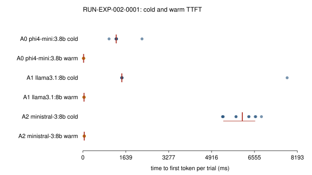

<!-- SPDX-License-Identifier: LicenseRef-TOKEN-NC-Research-1.0 -->
# EXP-002 report: cold-start versus warm latency of installed local models

**Status: CONFIRMATORY, two attempts.**

- **Attempt 1 (2026-11-25, Ollama 0.9.6): FAILED before any request. No results.** Kept unchanged in the section "Attempt 1" at the end of this report.
- **Attempt 2 (2026-11-26, Ollama 0.40.6, owner option a): COMPLETE.** 60 of 60 trials, 0 errors, 0 invalid start states, 0 excluded blocks. Verdict under the frozen rule: H1 supported (descriptive evidence; the ordering is confounded with prompt length, section 9).

## 1. Identification

- Experiment: EXP-002. Run: RUN-EXP-002-0001. Date: 2026-11-26. Protocol v1.0, frozen 2026-11-24, SHA-256 54d46696e6b479c83235c789839ae3acaaaeeac1f38eccc6ef7c399d191c011e.
- Config `experiments/EXP-002.json`, canonical SHA-256 6885e5f527df271897d6d2ba8f324fc73fd5135d250e92c8bd8dc94f4c3081cf (unchanged). Penalty analysis as committed before any EXP-002 data (DL-010).
- Code revision eadcedd7e959af12d40df967f842528a0cbde954, clean tree (`dirty: false`). Authorship: Mohamed Bechir Kefi (C3); the AI was used as a research and development assistant.
- **Dated deviation (owner-approved): runtime version 0.9.6 -> 0.40.6, owner option a** (owner, 2026-11-26, R-TOKEN-1; DL-015). Nothing else changed.

## 2. Executive summary

- Question: is the runtime-cold time-to-first-token (TTFT) penalty larger for larger model files (A0 2.49 < A1 4.92 < A2 6.02 GB)?
- Penalty (median cold TTFT minus median warm TTFT, 95 % bootstrap CI): A0 phi4-mini:3.8b 1,246.4 ms [1,242.3, 1,254.8]; A1 llama3.1:8b 1,443.8 ms [1,440.5, 1,450.3]; A2 ministral-3:8b 6,039.8 ms [5,310.1, 6,530.9].
- The ordering holds and adjacent intervals do not overlap: **H1 supported** under the frozen rule, as descriptive evidence from three configurations.
- Principal caveat: on 0.40.6 the A2 prompt is 631 tokens against 81 (A0) and 88 (A1), and the penalty contains uncached prefill as well as loading, so file size and prompt length are confounded. "Cold" is runtime-cold only.

## 3. Rationale

As in the frozen protocol, item 3: ollama-api (opened) documents `load_duration` and unloading with `keep_alive: 0`; no verified source measures cold-start penalties for these models on this class of hardware.

## 4. Hypotheses

Unchanged. Penalty_k = median cold TTFT_k minus median warm TTFT_k (ms). H0: the penalty does not increase with file size. H1: penalty(A0) < penalty(A1) < penalty(A2). Not supported on a reversal of the order in the point estimates; overlapping adjacent 95 % CIs are reported as unresolved.

## 5. Methodology (as frozen)

- Trials: per arm, 10 cold and 10 warm, alternating and starting cold; arm order from seed 2002 (A0, A1, A2); runtime seed 0. A cold trial unloads the arm's model and any other listed model with `keep_alive: 0` and confirms with `/api/ps` that no model is loaded; a warm trial follows a completed request to the same arm. No retries, no discarded warm-up.
- Prompt and decoding: one fixed validation prompt (Mercury_192290, template T1), temperature 0, num_predict 8, num_ctx 2048.
- Statistics: bootstrap over trials (10,000 resamples, seed 7, percentile intervals; cold and warm resampled independently).
- Hardware and software: as EXP-001 attempt 2 (Apple M1 Pro, 16 GB, macOS 15.3.1, AC power, Ollama 0.40.6 started by the rerun session, models verified without any pull).
- Budget: 60 requests plus unloads, 1-hour cap.

## 6. Implementation verification

- The penalty analysis was implemented and tested on the simulated backend before any EXP-002 output (DL-010, `tests/test_cold_warm_analysis.py`); full suite 162 passed before the rerun.
- The cold/warm mechanism had been exercised on the real runtime in the exploratory RUN-SMOKE-0006 (0.9.6, arm A0, a different item); those values are not used here.
- Exploratory smoke on 0.40.6 (RUN-SMOKE-0007, JRN-0010): all three arms described and ran.

## 7. Execution record

- Command: `nice -n 5 .venv/bin/token-lab run --config experiments/EXP-002.json`, then `token-lab report --result results/confirmatory/RUN-EXP-002-0001/result.json`.
- Start 2026-11-26T13:07:16Z, end 13:08:56Z, 99.3 s, exit 0. It ran after EXP-001 (attempt 2) had finished.
- Quiet-machine readings (same rule as EXP-001, DL-015): waiting 13:03:15Z load 1.63 with the EXP-001 model still loaded, 13:04:16Z 1.44, 13:05:16Z 1.27, 13:06:16Z 1.30; start load average 1.15 / 1.18 / 1.20, AC power, Low Power Mode off, no model loaded, swap used 5,521.81 MiB; end load 1.33 / 1.27 / 1.24.
- Counts: 3 blocks, 60 records, 0 request errors, 0 invalid start states (every cold trial had an empty `/api/ps` before its request), wall-clock cap not reached.
- Block check against the frozen criteria (after the run, DL-011 gap 2): no block met any criterion (largest swap growth 0.0 MiB, no foreign model, AC power at start and end, one runtime version).

## 8. Results

| Arm (file size) | Cold TTFT median [95 % CI] (ms) | Warm TTFT median [95 % CI] (ms) | Penalty [95 % CI] (ms) |
|---|---|---|---|
| A0 phi4-mini:3.8b (2.49 GB) | 1,273.9 [1,269.2, 1,281.6] | 27.5 [25.7, 27.8] | 1,246.4 [1,242.3, 1,254.8] |
| A1 llama3.1:8b (4.92 GB) | 1,488.5 [1,485.3, 1,495.0] | 44.7 [44.0, 44.9] | 1,443.8 [1,440.5, 1,450.3] |
| A2 ministral-3:8b (6.02 GB) | 6,091.7 [5,362.2, 6,582.7] | 51.9 [51.7, 52.2] | 6,039.8 [5,310.1, 6,530.9] |

| Arm | Cold load median (ms) | Cold prefill median (ms) | Warm prefill median (ms) | Prompt length (tokens) | Cold latency median (ms) | Warm latency median (ms) |
|---|---|---|---|---|---|---|
| A0 | 1,063.0 | 202.5 | 22.4 | 81 | 1,300.7 | 49.7 |
| A1 | 1,081.7 | 403.0 | 40.9 | 88 | 1,533.1 | 84.9 |
| A2 | 3,359.6 | 2,716.3 | 44.1 | 631 | 6,138.2 | 98.0 |

- Ordering check by file size (frozen rule, `cold_warm_ordering`): ordering holds, no reversal, no adjacent CI overlap: **H1 supported**.
- The first cold trial of A0 (2,258.4 ms) and of A1 (7,803.0 ms) was the slowest of its arm; A2's cold trials alternated between about 5.3 to 5.9 s and 6.3 to 6.8 s.
- All responses were identical within each arm (A0 "D", A1 "A", A2 "D"; the item's answer key is not used by this experiment).
- Figure FIG-003 (`figures/FIG-003-exp002-cold-warm.svg`): every trial per arm and state; red bar the median, red line its 95 % CI.

## 9. Interpretation

- **Expected versus observed.** The frozen prediction (the penalty grows with file size) held: about 1.25 s, 1.44 s and 6.04 s.
- **What the penalty contains.** A cold request pays for loading the model and for prefill without reusable state; a warm request in this design repeats the same prompt and pays almost neither (warm prefill 22.4 to 44.1 ms). For A0 and A1 the penalty is mostly loading (about 1.06 to 1.08 s) plus 0.2 to 0.4 s of prefill. For A2 both parts are larger: 3.36 s of loading and 2.72 s of prefill of a prompt about seven times longer, because the ministral-3:8b template on 0.40.6 adds a default system text. The size ordering is therefore confounded with prompt length; three configurations cannot separate them.
- **Loading is not proportional to file size.** A1's file is about twice A0's, yet their cold load medians differ by about 19 ms; A2's is about three times as long. The OS page cache (not purged, protocol item 8) is one possible explanation; it was not tested (the item-20 page-cache check is exploratory and has no frozen config).

## 10. Threats to validity

- Internal: runtime-cold only; the page cache may hold the weights. The warm state repeats an identical prompt, so warm TTFT benefits from prompt reuse by design.
- Confounding: prompt length differs by arm (81, 88, 631 tokens); A2's system text depends on the run date (`currentDate`).
- External: one machine, one runtime version (0.40.6, different from EXP-003's 0.9.6), one prompt, ten trials per cell.
- Statistical: intervals are over ten trials per cell within one session; with three configurations the result is descriptive, and no scaling law is claimed.

## 11. Conclusion and next step

On this laptop with Ollama 0.40.6, runtime-cold requests cost 1.2 to 6.0 s more than warm ones, and the penalty increased with file size as the frozen hypothesis predicted (H1 supported, descriptive). Because A2's prompt is much longer on this runtime, the result does not show how much of the increase is due to file size alone. Possible next steps, all needing the owner: the exploratory page-cache check of protocol item 20 under a frozen config; a design that equalises prompt length across arms.

## 12. Reproduction appendix

- Environment, data and runtime as EXP-001 attempt 2 (`research/experiments/EXP-001/report.md`, section 12).
- Run: `.venv/bin/token-lab run --config experiments/EXP-002.json` (it unloads every listed model; use a runtime no one else is using).
- Report and figures: `.venv/bin/token-lab report --result results/confirmatory/RUN-EXP-002-0001/result.json`.
- Raw outputs: `results/confirmatory/RUN-EXP-002-0001/` (all hashes in `sha256_manifest.json`). Copies in this folder: `config.json`, `run_manifest.json`, `metrics.csv`, `cold_warm.csv`, `figures/FIG-003-exp002-cold-warm.svg`. Prefill and prompt-length values: `results/exploratory/RERUN-EXPL-0001/prompts_and_rss.json`.
- Records: JRN-0010, JRN-0012; DL-015, DL-016; claims CLM-022 to CLM-025.

## Attempt 1 (2026-11-25, Ollama 0.9.6): FAILED before any request (kept as written)

**Label: CONFIRMATORY ATTEMPT, FAILED. No results exist from this attempt.** The text below is the report of the first attempt, unchanged except that its headings are one level lower. The owner's choice it asks for was made on 2026-11-26: option (a) (R-TOKEN-1; DL-015). The second attempt is reported above.

### 1. Identification

- Experiment: EXP-002. Date: 2026-11-25. Protocol v1.0, frozen 2026-11-24, SHA-256 54d46696e6b479c83235c789839ae3acaaaeeac1f38eccc6ef7c399d191c011e.
- Config canonical SHA-256 6885e5f527df271897d6d2ba8f324fc73fd5135d250e92c8bd8dc94f4c3081cf. Code revision 57f6187e7b450fea05eedbbee8c663943596a699, which includes the penalty analysis committed before any EXP-002 output (DL-010).
- Authorship: Mohamed Bechir Kefi (C3); the AI was used as a research and development assistant.

### 2. Executive summary

- Question: is the runtime-cold TTFT penalty larger for larger model files (A0 < A1 < A2)?
- Outcome: the frozen run aborted before any request, for the same cause as EXP-001. Ollama 0.9.6 cannot describe or run ministral-3:8b (A2).
- No penalty was measured, and the hypothesis is untested.

### 3. Rationale

As in the frozen protocol, item 3.

### 4. Hypotheses

Unchanged and untested.

- Penalty_k = median cold TTFT minus median warm TTFT (ms).
- H1: penalty(A0) < penalty(A1) < penalty(A2).
- Not supported on a reversal of that order in the point estimates, or on overlapping adjacent 95 % CIs; the latter case is reported as unresolved.

### 5. Methodology (as frozen)

- Trials: per arm, 10 cold and 10 warm, alternating and starting cold. Arm order comes from seed 2002. Runtime seed 0.
- Prompt and decoding: one fixed validation prompt (Mercury_192290, template T1), temperature 0, num_predict 8, num_ctx 2048.
- Statistics: bootstrap over trials (10,000 resamples, seed 7, percentile intervals).
- Budget: 1-hour cap.

### 6. Implementation verification

- The penalty analysis was implemented and tested on the simulated backend before any EXP-002 output (`tests/test_cold_warm_analysis.py`).
- The cold/warm mechanism was exercised on the real runtime in the exploratory RUN-SMOKE-0006, on arm A0 with a different validation item (Mercury_7103180):
  - 5 cold and 5 warm trials, all with a valid confirmed start state.
  - Exploratory values only, with a concurrent model download: cold TTFT median 968.4 ms, warm 55.1 ms, penalty 913.3 ms [903.2, 916.9].
- These values are not confirmatory and are not used for any claim.

### 7. Execution record

- Command: `.venv/bin/token-lab run --config experiments/EXP-002.json`, at 2026-11-25T12:08:06Z.
- Machine state: load average 2.56 / 2.27 / 2.02, AC power.
- What happened: the run passed the freeze guard and the item checks, then aborted at the A2 `/api/show` fingerprint (F8).
- Output: exit 3, "backend error: HTTP 500 ... currentDate not defined". Generation requests: 0. No result file (JRN-0007, DL-011).

### 8. Results

None. Requests run: 0 of 60.

### 9. Interpretation

Runtime compatibility failure; this says nothing about cold-start behaviour.

### 10. Threats to validity

Not applicable to results.

### 11. Conclusion and next step

No conclusion. The owner options are the same as for EXP-001 (DL-011, a to c). The analysis code is ready and frozen in behaviour (DL-010).

### 12. Reproduction appendix

To reproduce the failure: start Ollama 0.9.6, then run `.venv/bin/token-lab run --config experiments/EXP-002.json`. Expected result: exit 3. Records: JRN-0006, JRN-0007, DL-010, DL-011. Exploratory cold/warm smoke: `results/exploratory/RUN-SMOKE-0006/` (`cold_warm.csv`, `cold_warm.svg`).

### Addendum (M4, 2026-11-25)

The status is unchanged: **failed before any request, no results.** M4 ran no inference and did not contact the runtime. This experiment is reported in the manuscript (Sections 5.1, 5.2, Tables 1 and 5) with the same prominence as EXP-003, and no statement about its hypotheses is made anywhere. The owner's choice remains pending and is not decided by the M4 instruction (owner, 2026-11-25, "Next"):

- (a) upgrade Ollama (a download, and a runtime change for the owner's other projects), then run the frozen matrix unchanged with the new runtime version recorded as a deviation;
- (b) a new freeze that drops or replaces A2 ministral-3:8b, which is a new protocol version;
- (c) keep the experiment recorded as failed.

Records: DL-011, DL-012, JRN-0007; claims CLM-004 and CLM-005.
