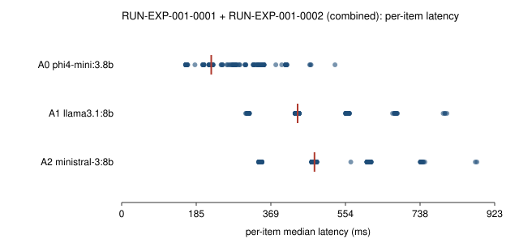

<!-- SPDX-License-Identifier: LicenseRef-TOKEN-NC-Research-1.0 -->
# Combined analysis RUN-EXP-001-0001 + RUN-EXP-001-0002

**Label: CONFIRMATORY.**

## Provenance

- Experiment: EXP-001; run: RUN-EXP-001-0002; schema 1.0.0
- Config SHA-256: `355d86f1cd3bc28373bef6e3e36c32828337583b0893d2b87d4c33fa48c7913e`
- Protocol SHA-256: `1997317c931cf95d04c271ab2414aef82306f5976f1eea7262eb1e4d54fee8e4`
- Git revision: `c7d1ba666b258450c6780df755362b81d0e218ef` (dirty: False)
- Backend: ollama (simulated: False), runtime version 0.40.6
- Items: `results/raw/arc/ARC-Challenge-test.jsonl`, 300 items, SHA-256 `86ccaace4cd159b5c02b6b3339ebe8a7022a54f1b488e433c060b3bc38ac1f63`
- Host: Apple M1 Pro, macOS-15.3.1-arm64-arm-64bit, power ac, load average at start [1.68, 2.55, 2.78]
- Start 2026-11-26T12:31:06Z, end 2026-11-26T14:15:52Z, runtime 2077.488 s, 4500 requests, 0 failures
- Harness peak RSS: 58.6 MiB

## Block rules (protocol section 9)

- Combined analysis input: RUN-EXP-001-0001 with block 3 (A1, repetition 0), block 11 (A0, repetition 3) replaced by the repeat run RUN-EXP-001-0002; the repeated blocks replace the excluded ones (protocol section 9). Source result SHA-256 `f95ee2055a9048559162cf8417a63f31682e5bf23dd724e0813b38e197cd003c`.
- Windows: RUN-EXP-001-0001 2026-11-26T12:31:06Z to 2026-11-26T13:01:55Z (revision `ca3a08fb536fbb80196354b5bdc0b3c26b38aa56`); RUN-EXP-001-0002 2026-11-26T14:12:03Z to 2026-11-26T14:15:52Z (revision `c7d1ba666b258450c6780df755362b81d0e218ef`). Start, end and runtime under Provenance span both runs (runtime is the sum); the git revision, harness RSS and the rule outcome below are the repeat run's.
- Blocks in the analysis: 15 of 15 planned; missing: none. Status: **complete**. Total runtime of both runs: 2077.5 s.
- Rule outcome of the repeat run: **complete**. Thresholds: swap growth above 512 MiB excludes, above 2048 MiB aborts; wall-clock cap 12551 s.

| Block | Arm | Repetition | Origin | Status | Swap delta (MiB) | Peak swap growth (MiB) | Loaded before | Loaded after |
|---|---|---|---|---|---|---|---|---|
| 1 | A0 | 0 | RUN-EXP-001-0001 | included (rules not enforced) | 0.0 | n/a | none | phi4-mini:3.8b |
| 2 | A2 | 0 | RUN-EXP-001-0001 | included (rules not enforced) | 0.0 | n/a | phi4-mini:3.8b | ministral-3:8b |
| 3 | A1 | 0 | RUN-EXP-001-0002 | included | 426.3 | 426.3 | none | llama3.1:8b |
| 4 | A2 | 1 | RUN-EXP-001-0001 | included (rules not enforced) | 0.0 | n/a | llama3.1:8b | ministral-3:8b |
| 5 | A1 | 1 | RUN-EXP-001-0001 | included (rules not enforced) | 0.0 | n/a | ministral-3:8b | llama3.1:8b |
| 6 | A0 | 1 | RUN-EXP-001-0001 | included (rules not enforced) | 0.0 | n/a | llama3.1:8b | phi4-mini:3.8b |
| 7 | A0 | 2 | RUN-EXP-001-0001 | included (rules not enforced) | 0.0 | n/a | phi4-mini:3.8b | phi4-mini:3.8b |
| 8 | A2 | 2 | RUN-EXP-001-0001 | included (rules not enforced) | 0.0 | n/a | phi4-mini:3.8b | ministral-3:8b |
| 9 | A1 | 2 | RUN-EXP-001-0001 | included (rules not enforced) | -8.0 | n/a | ministral-3:8b | llama3.1:8b |
| 10 | A2 | 3 | RUN-EXP-001-0001 | included (rules not enforced) | 0.0 | n/a | llama3.1:8b | ministral-3:8b |
| 11 | A0 | 3 | RUN-EXP-001-0002 | included | -8.0 | 0.0 | llama3.1:8b | phi4-mini:3.8b |
| 12 | A1 | 3 | RUN-EXP-001-0001 | included (rules not enforced) | -374.2 | n/a | phi4-mini:3.8b, ministral-3:8b | llama3.1:8b |
| 13 | A0 | 4 | RUN-EXP-001-0001 | included (rules not enforced) | -48.0 | n/a | llama3.1:8b | phi4-mini:3.8b |
| 14 | A1 | 4 | RUN-EXP-001-0001 | included (rules not enforced) | -120.1 | n/a | phi4-mini:3.8b | llama3.1:8b |
| 15 | A2 | 4 | RUN-EXP-001-0001 | included (rules not enforced) | -1608.8 | n/a | llama3.1:8b | ministral-3:8b |

## Per-arm metrics

Accuracy: per-item mean over repetitions, then mean over items. Latency: per-item median over repetitions, then median [Q1, Q3] over items (ms).

| Arm | Model | n items | Acc. strict | Acc. lenient | Chance | Errors | Format fail strict | Format fail lenient |
|---|---|---|---|---|---|---|---|---|
| A0 | phi4-mini:3.8b | 300 | 0.560 | 0.813 | 0.251 | 0 | 520 | 0 |
| A1 | llama3.1:8b | 300 | 0.720 | 0.720 | 0.251 | 0 | 10 | 0 |
| A2 | ministral-3:8b | 300 | 0.893 | 0.897 | 0.251 | 0 | 5 | 0 |

| Arm | Latency median [Q1, Q3] (ms) | TTFT median (ms) | Decode (tok/s) | Prefill (tok/s) | Determinism | Peak RSS (MiB) | Max swap delta (MiB) |
|---|---|---|---|---|---|---|---|
| A0 | 221.62 [218.19, 306.88] | 195.17 | 88.7 | 459.0 | 1.00 | 32.2 | 0.0 |
| A1 | 435.27 [431.40, 555.63] | 394.02 | 49.1 | 227.2 | 1.00 | 34.3 | 426.3 |
| A2 | 476.81 [470.90, 606.89] | 430.42 | 45.7 | 1502.3 | 1.00 | 28.0 | 0.0 |

## Spread between repetitions (seeds)

| Arm | Accuracy per repetition | Median latency per repetition (ms) | CV of repetition medians |
|---|---|---|---|
| A0 | 0.560, 0.560, 0.560, 0.560, 0.560 | 222.16, 222.19, 50.12, 222.55, 221.71 | 0.410 |
| A1 | 0.720, 0.720, 0.720, 0.720, 0.720 | 437.41, 434.51, 434.59, 435.92, 434.94 | 0.003 |
| A2 | 0.893, 0.893, 0.893, 0.893, 0.893 | 476.63, 476.30, 476.68, 476.96, 476.73 | 0.000499 |

## Paired contrasts against the baseline

Paired bootstrap over items (10,000 resamples, seed 7, percentile 95 % CI); exact McNemar; Holm within each extraction rule.

| Arm vs baseline | Extraction | n | Delta (pp) | 95 % CI (pp) | b | c | McNemar p | Holm p |
|---|---|---|---|---|---|---|---|---|
| A1 vs A0 | strict | 300 | 16.0 | [9.7, 22.3] | 75 | 27 | 2.15e-06 | 2.15e-06 |
| A2 vs A0 | strict | 300 | 33.3 | [27.7, 39.3] | 108 | 8 | 1.65e-23 | 3.3e-23 |
| A1 vs A0 | lenient | 300 | -9.3 | [-14.7, -4.3] | 19 | 47 | 0.000756 | 0.000756 |
| A2 vs A0 | lenient | 300 | 8.3 | [4.0, 12.7] | 35 | 10 | 0.000247 | 0.000494 |

## Projection of planned matrices

Measured seconds per request in this run (block wall time including warm-ups): 0.4097.

| Planned experiment | Planned requests | Projected hours |
|---|---|---|
| EXP-001 | 4500 | 0.5121 |
| EXP-002 | 60 | 0.0068 |
| EXP-003 | 3000 | 0.3414 |

## Figure

