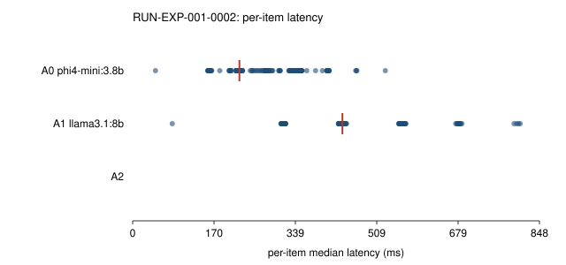

<!-- SPDX-License-Identifier: LicenseRef-TOKEN-NC-Research-1.0 -->
# Run report RUN-EXP-001-0002

**Label: CONFIRMATORY.**

## Provenance

- Experiment: EXP-001; run: RUN-EXP-001-0002; schema 1.0.0
- Config SHA-256: `355d86f1cd3bc28373bef6e3e36c32828337583b0893d2b87d4c33fa48c7913e`
- Protocol SHA-256: `1997317c931cf95d04c271ab2414aef82306f5976f1eea7262eb1e4d54fee8e4`
- Git revision: `c7d1ba666b258450c6780df755362b81d0e218ef` (dirty: False)
- Backend: ollama (simulated: False), runtime version 0.40.6
- Items: `results/raw/arc/ARC-Challenge-test.jsonl`, 300 items, SHA-256 `86ccaace4cd159b5c02b6b3339ebe8a7022a54f1b488e433c060b3bc38ac1f63`
- Host: Apple M1 Pro, macOS-15.3.1-arm64-arm-64bit, power ac, load average at start [1.67, 1.7, 1.77]
- Start 2026-11-26T14:12:03Z, end 2026-11-26T14:15:52Z, runtime 228.358 s, 600 requests, 0 failures
- Harness peak RSS: 58.6 MiB

## Block rules (protocol section 9)

- Block repeat of RUN-EXP-001-0001 (SHA-256 `f95ee2055a9048559162cf8417a63f31682e5bf23dd724e0813b38e197cd003c`): block 3 (A1, repetition 0), block 11 (A0, repetition 3).
- Source block 3 criteria: swap grew by 734.1 MiB (more than 512 MiB).
- Source block 11 criteria: swap grew by 2778.1 MiB (more than 512 MiB); swap growth 2778.1 MiB above 2 GiB (memory exhaustion).
- Rule outcome of the repeat run: **complete**. Thresholds: swap growth above 512 MiB excludes, above 2048 MiB aborts; wall-clock cap 12551 s.

| Block | Arm | Repetition | Origin | Status | Swap delta (MiB) | Peak swap growth (MiB) | Loaded before | Loaded after |
|---|---|---|---|---|---|---|---|---|
| 3 | A1 | 0 | RUN-EXP-001-0002 | included | 426.3 | 426.3 | none | llama3.1:8b |
| 11 | A0 | 3 | RUN-EXP-001-0002 | included | -8.0 | 0.0 | llama3.1:8b | phi4-mini:3.8b |

## Per-arm metrics

Accuracy: per-item mean over repetitions, then mean over items. Latency: per-item median over repetitions, then median [Q1, Q3] over items (ms).

| Arm | Model | n items | Acc. strict | Acc. lenient | Chance | Errors | Format fail strict | Format fail lenient |
|---|---|---|---|---|---|---|---|---|
| A0 | phi4-mini:3.8b | 300 | 0.560 | 0.813 | 0.251 | 0 | 104 | 0 |
| A1 | llama3.1:8b | 300 | 0.720 | 0.720 | 0.251 | 0 | 2 | 0 |
| A2 | | 0 | | | | | | |

| Arm | Latency median [Q1, Q3] (ms) | TTFT median (ms) | Decode (tok/s) | Prefill (tok/s) | Determinism | Peak RSS (MiB) | Max swap delta (MiB) |
|---|---|---|---|---|---|---|---|
| A0 | 222.55 [218.41, 307.31] | 196.42 | 88.5 | 444.2 | 1.00 | 32.2 | -8.0 |
| A1 | 437.41 [433.24, 557.67] | 395.98 | 49.1 | 226.4 | 1.00 | 34.3 | 426.3 |

## Spread between repetitions (seeds)

| Arm | Accuracy per repetition | Median latency per repetition (ms) | CV of repetition medians |
|---|---|---|---|
| A0 | 0.560 | 222.55 | n/a |
| A1 | 0.720 | 437.41 | n/a |

## Paired contrasts against the baseline

Paired bootstrap over items (10,000 resamples, seed 7, percentile 95 % CI); exact McNemar; Holm within each extraction rule.

| Arm vs baseline | Extraction | n | Delta (pp) | 95 % CI (pp) | b | c | McNemar p | Holm p |
|---|---|---|---|---|---|---|---|---|
| A1 vs A0 | strict | 300 | 16.0 | [9.7, 22.3] | 75 | 27 | 2.15e-06 | 2.15e-06 |
| A1 vs A0 | lenient | 300 | -9.3 | [-14.7, -4.3] | 19 | 47 | 0.000756 | 0.000756 |

## Projection of planned matrices

Measured seconds per request in this run (block wall time including warm-ups): 0.3792.

| Planned experiment | Planned requests | Projected hours |
|---|---|---|
| EXP-001 | 4500 | 0.4740 |
| EXP-002 | 60 | 0.0063 |
| EXP-003 | 3000 | 0.3160 |

## Figure

