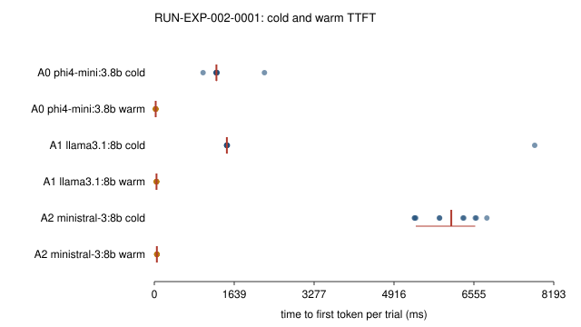
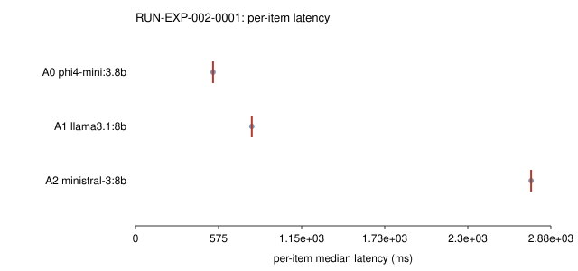

<!-- SPDX-License-Identifier: LicenseRef-TOKEN-NC-Research-1.0 -->
# Run report RUN-EXP-002-0001

**Label: CONFIRMATORY.**

## Provenance

- Experiment: EXP-002; run: RUN-EXP-002-0001; schema 1.0.0
- Config SHA-256: `6885e5f527df271897d6d2ba8f324fc73fd5135d250e92c8bd8dc94f4c3081cf`
- Protocol SHA-256: `54d46696e6b479c83235c789839ae3acaaaeeac1f38eccc6ef7c399d191c011e`
- Git revision: `eadcedd7e959af12d40df967f842528a0cbde954` (dirty: False)
- Backend: ollama (simulated: False), runtime version 0.40.6
- Items: `results/raw/arc/ARC-Challenge-validation.jsonl`, 1 items, SHA-256 `16b59737cb520f748020546b5e3fa76f0893d1a1237bb350dd81dd43a09f151b`
- Host: Apple M1 Pro, macOS-15.3.1-arm64-arm-64bit, power ac, load average at start [1.15, 1.18, 1.2]
- Start 2026-11-26T13:07:16Z, end 2026-11-26T13:08:56Z, runtime 99.313 s, 60 requests, 0 failures
- Harness peak RSS: 44.6 MiB

## Per-arm metrics

Accuracy: per-item mean over repetitions, then mean over items. Latency: per-item median over repetitions, then median [Q1, Q3] over items (ms).

| Arm | Model | n items | Acc. strict | Acc. lenient | Chance | Errors | Format fail strict | Format fail lenient |
|---|---|---|---|---|---|---|---|---|
| A0 | phi4-mini:3.8b | 1 | 1.000 | 1.000 | 0.250 | 0 | 0 | 0 |
| A1 | llama3.1:8b | 1 | 0.000 | 0.000 | 0.250 | 0 | 0 | 0 |
| A2 | ministral-3:8b | 1 | 1.000 | 1.000 | 0.250 | 0 | 0 | 0 |

| Arm | Latency median [Q1, Q3] (ms) | TTFT median (ms) | Decode (tok/s) | Prefill (tok/s) | Determinism | Peak RSS (MiB) | Max swap delta (MiB) |
|---|---|---|---|---|---|---|---|
| A0 | 537.26 [537.26, 537.26] | 514.33 | 90.4 | 1990.3 | 1.00 | 28.0 | 0.0 |
| A1 | 805.49 [805.49, 805.49] | 763.37 | 49.6 | 1182.1 | 1.00 | 28.7 | -8.0 |
| A2 | 2739.66 [2739.66, 2739.66] | 2692.95 | 45.8 | 7250.5 | 1.00 | 29.2 | -24.0 |

## Spread between repetitions (seeds)

| Arm | Accuracy per repetition | Median latency per repetition (ms) | CV of repetition medians |
|---|---|---|---|
| A0 | 1.000 | 537.26 | n/a |
| A1 | 0.000 | 805.49 | n/a |
| A2 | 1.000 | 2739.66 | n/a |

## Cold-start penalty (EXP-002 items 5, 6 and 16)

Penalty = median cold TTFT minus median warm TTFT (ms) over the valid trials of each arm. Percentile 95 % bootstrap CIs over trials (10,000 resamples, seed 7; cold and warm trials resampled independently). Load duration and end-to-end latency medians are descriptive.

| Arm | Model | Valid cold / warm | Invalid cold / warm | Cold TTFT median [95 % CI] (ms) | Warm TTFT median [95 % CI] (ms) | Penalty [95 % CI] (ms) |
|---|---|---|---|---|---|---|
| A0 | phi4-mini:3.8b | 10 / 10 | 0 / 0 | 1273.9 [1269.2, 1281.6] | 27.5 [25.7, 27.8] | 1246.4 [1242.3, 1254.8] |
| A1 | llama3.1:8b | 10 / 10 | 0 / 0 | 1488.5 [1485.3, 1495.0] | 44.7 [44.0, 44.9] | 1443.8 [1440.5, 1450.3] |
| A2 | ministral-3:8b | 10 / 10 | 0 / 0 | 6091.7 [5362.2, 6582.7] | 51.9 [51.7, 52.2] | 6039.8 [5310.1, 6530.9] |

| Arm | Cold load median (ms) | Warm load median (ms) | Cold latency median (ms) | Warm latency median (ms) |
|---|---|---|---|---|
| A0 | 1063.0 | 1.0 | 1300.7 | 49.7 |
| A1 | 1081.7 | 0.9 | 1533.1 | 84.9 |
| A2 | 3359.6 | 0.6 | 6138.2 | 98.0 |

Ordering check by file size (A0 < A1 < A2): **H1 supported (ordering holds and adjacent CIs do not overlap)**. Reversal: False; adjacent CI overlap: False.

## Projection of planned matrices

Measured seconds per request in this run (block wall time including warm-ups): 1.6547.

| Planned experiment | Planned requests | Projected hours |
|---|---|---|
| EXP-001 | 4500 | 2.0684 |
| EXP-002 | 60 | 0.0276 |
| EXP-003 | 3000 | 1.3790 |

## Figure

