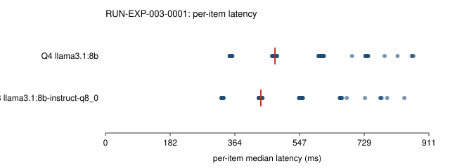

<!-- SPDX-License-Identifier: LicenseRef-TOKEN-NC-Research-1.0 -->
# Run report RUN-EXP-003-0001

**Label: CONFIRMATORY.**

## Provenance

- Experiment: EXP-003; run: RUN-EXP-003-0001; schema 1.0.0
- Config SHA-256: `3ebe5b2a60e4ddb6ae1c8e1e35f3d316f35f0fd56272f90299b992e702065560`
- Protocol SHA-256: `8196740a07ce6b0d0e254a23729aa18e5866e0b72b7ac3dd97b779e23a024068`
- Git revision: `57f6187e7b450fea05eedbbee8c663943596a699` (dirty: True)
- Backend: ollama (simulated: False), runtime version 0.9.6
- Items: `results/raw/arc/ARC-Challenge-test.jsonl`, 300 items, SHA-256 `86ccaace4cd159b5c02b6b3339ebe8a7022a54f1b488e433c060b3bc38ac1f63`
- Host: Apple M1 Pro, macOS-15.3.1-arm64-arm-64bit, power ac, load average at start [2.29, 3.09, 3.04]
- Start 2026-11-25T12:30:58Z, end 2026-11-25T12:56:08Z, runtime 1509.791 s, 3000 requests, 0 failures
- Harness peak RSS: 44.2 MiB

## Per-arm metrics

Accuracy: per-item mean over repetitions, then mean over items. Latency: per-item median over repetitions, then median [Q1, Q3] over items (ms).

| Arm | Model | n items | Acc. strict | Acc. lenient | Chance | Errors | Format fail strict | Format fail lenient |
|---|---|---|---|---|---|---|---|---|
| Q4 | llama3.1:8b | 300 | 0.717 | 0.720 | 0.251 | 0 | 15 | 0 |
| Q8 | llama3.1:8b-instruct-q8_0 | 300 | 0.733 | 0.737 | 0.251 | 0 | 20 | 0 |

| Arm | Latency median [Q1, Q3] (ms) | TTFT median (ms) | Decode (tok/s) | Prefill (tok/s) | Determinism | Peak RSS (MiB) | Max swap delta (MiB) |
|---|---|---|---|---|---|---|---|
| Q4 | 477.49 [472.93, 603.16] | 440.94 | 53.9 | 214.4 | 1.00 | 965.0 | 0.0 |
| Q8 | 437.74 [434.26, 547.16] | 388.68 | 40.1 | 245.3 | 1.00 | 932.3 | 61.1 |

## Spread between repetitions (seeds)

| Arm | Accuracy per repetition | Median latency per repetition (ms) | CV of repetition medians |
|---|---|---|---|
| Q4 | 0.717, 0.717, 0.717, 0.717, 0.717 | 478.09, 478.21, 476.15, 477.63, 477.40 | 0.002 |
| Q8 | 0.733, 0.733, 0.733, 0.733, 0.733 | 439.98, 437.85, 437.69, 437.71, 437.78 | 0.002 |

## Paired contrasts against the baseline

Paired bootstrap over items (10,000 resamples, seed 7, percentile 95 % CI); exact McNemar; Holm within each extraction rule.

| Arm vs baseline | Extraction | n | Delta (pp) | 95 % CI (pp) | b | c | McNemar p | Holm p |
|---|---|---|---|---|---|---|---|---|
| Q8 vs Q4 | strict | 300 | 1.7 | [-1.0, 4.3] | 11 | 6 | 0.332 | 0.332 |
| Q8 vs Q4 | lenient | 300 | 1.7 | [-1.0, 4.3] | 11 | 6 | 0.332 | 0.332 |

## Projection of planned matrices

Measured seconds per request in this run (block wall time including warm-ups): 0.5016.

| Planned experiment | Planned requests | Projected hours |
|---|---|---|
| EXP-001 | 4500 | 0.6270 |
| EXP-002 | 60 | 0.0084 |
| EXP-003 | 3000 | 0.4180 |

## Figure

