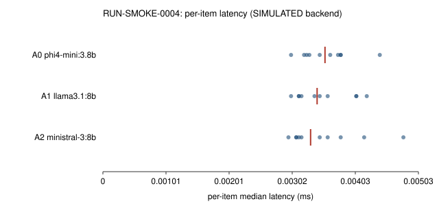

<!-- SPDX-License-Identifier: LicenseRef-TOKEN-NC-Research-1.0 -->
# Run report RUN-SMOKE-0004

**Label: EXPLORATORY.** Exploratory output; not a finding and not usable for confirmatory analysis. Backend is SIMULATED: no model ran. Accuracy values are artefacts of a hash function and latencies measure the harness only. Items are a synthetic fixture, not a benchmark.

## Provenance

- Experiment: SMOKE; run: RUN-SMOKE-0004; schema 1.0.0
- Config SHA-256: `837ec4d2faeac9a74ee9ea5d45e75e9974a789c6eb0fed210804d659158ae1bf`
- Protocol SHA-256: `None`
- Git revision: `b24694be2f7471b544c3d8efb0cbe64b8045a305` (dirty: True)
- Backend: simulated (simulated: True), runtime version simulated-0
- Items: `data/fixtures/synthetic_mc.jsonl`, 10 items, SHA-256 `3f7a73ff0c3295d711d8b258ce83025d90e9ebd5ce1e23279d63d0c95bceb86f`
- Host: Apple M1 Pro, macOS-15.3.1-arm64-arm-64bit, power ac, load average at start [4.73, 3.83, 2.95]
- Start 2026-11-24T16:01:50Z, end 2026-11-24T16:01:50Z, runtime 0.167 s, 150 requests, 0 failures
- Harness peak RSS: 45.3 MiB

## Per-arm metrics

Accuracy: per-item mean over repetitions, then mean over items. Latency: per-item median over repetitions, then median [Q1, Q3] over items (ms).

| Arm | Model | n items | Acc. strict | Acc. lenient | Chance | Errors | Format fail strict | Format fail lenient |
|---|---|---|---|---|---|---|---|---|
| A0 | phi4-mini:3.8b | 10 | 0.300 | 0.300 | 0.253 | 0 | 0 | 0 |
| A1 | llama3.1:8b | 10 | 0.000 | 0.000 | 0.253 | 0 | 0 | 0 |
| A2 | ministral-3:8b | 10 | 0.400 | 0.400 | 0.253 | 0 | 5 | 5 |

| Arm | Latency median [Q1, Q3] (ms) | TTFT median (ms) | Decode (tok/s) | Prefill (tok/s) | Determinism | Peak RSS (MiB) | Max swap delta (MiB) |
|---|---|---|---|---|---|---|---|
| A0 | 0.00354 [0.00326, 0.00378] | 0.00348 | 1000000.0 | 1000000.0 | 1.00 | n/a | 0.0 |
| A1 | 0.00342 [0.00314, 0.00393] | 0.00344 | 1000000.0 | 1000000.0 | 1.00 | n/a | 0.0 |
| A2 | 0.00331 [0.00309, 0.00374] | 0.00333 | 1000000.0 | 1000000.0 | 1.00 | n/a | 0.0 |

## Spread between repetitions (seeds)

| Arm | Accuracy per repetition | Median latency per repetition (ms) | CV of repetition medians |
|---|---|---|---|
| A0 | 0.300, 0.300, 0.300, 0.300, 0.300 | 0.00356, 0.00331, 0.00392, 0.00346, 0.00348 | 0.064 |
| A1 | 0.000, 0.000, 0.000, 0.000, 0.000 | 0.00348, 0.00335, 0.00344, 0.00337, 0.00371 | 0.041 |
| A2 | 0.400, 0.400, 0.400, 0.400, 0.400 | 0.00317, 0.00352, 0.00329, 0.00331, 0.00373 | 0.065 |

## Paired contrasts against the baseline

Paired bootstrap over items (10,000 resamples, seed 7, percentile 95 % CI); exact McNemar; Holm within each extraction rule.

| Arm vs baseline | Extraction | n | Delta (pp) | 95 % CI (pp) | b | c | McNemar p | Holm p |
|---|---|---|---|---|---|---|---|---|
| A1 vs A0 | strict | 10 | -30.0 | [-60.0, 0.0] | 0 | 3 | 0.25 | 0.5 |
| A2 vs A0 | strict | 10 | 10.0 | [-30.0, 50.0] | 3 | 2 | 1 | 1 |
| A1 vs A0 | lenient | 10 | -30.0 | [-60.0, 0.0] | 0 | 3 | 0.25 | 0.5 |
| A2 vs A0 | lenient | 10 | 10.0 | [-30.0, 50.0] | 3 | 2 | 1 | 1 |

## Projection of planned matrices

Measured seconds per request in this run (block wall time including warm-ups): 0.0008. The backend is simulated, so this projection says nothing about inference time.

| Planned experiment | Planned requests | Projected hours |
|---|---|---|
| EXP-001 | 4500 | 0.0010 |
| EXP-002 | 60 | 1.35e-05 |
| EXP-003 | 3000 | 0.0007 |

## Figure

