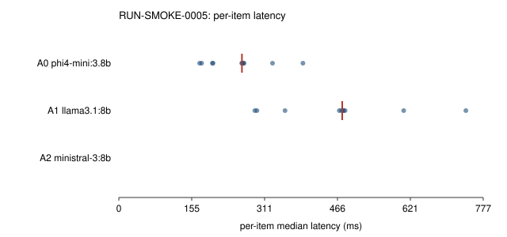

<!-- SPDX-License-Identifier: LicenseRef-TOKEN-NC-Research-1.0 -->
# Run report RUN-SMOKE-0005

**Label: EXPLORATORY.** Exploratory output; not a finding and not usable for confirmatory analysis.

## Provenance

- Experiment: SMOKE; run: RUN-SMOKE-0005; schema 1.0.0
- Config SHA-256: `c72c5e8ce6ca19a742f634f2cd52f7611b9afb21b19647fd119bf19288180e9d`
- Protocol SHA-256: `None`
- Git revision: `57f6187e7b450fea05eedbbee8c663943596a699` (dirty: False)
- Backend: ollama (simulated: False), runtime version 0.9.6
- Items: `results/raw/arc/ARC-Challenge-validation.jsonl`, 10 items, SHA-256 `16b59737cb520f748020546b5e3fa76f0893d1a1237bb350dd81dd43a09f151b`
- Host: Apple M1 Pro, macOS-15.3.1-arm64-arm-64bit, power ac, load average at start [2.07, 1.98, 1.9]
- Start 2026-11-25T12:06:22Z, end 2026-11-25T12:06:51Z, runtime 28.768 s, 60 requests, 22 failures
- Harness peak RSS: 43.6 MiB

## Per-arm metrics

Accuracy: per-item mean over repetitions, then mean over items. Latency: per-item median over repetitions, then median [Q1, Q3] over items (ms).

| Arm | Model | n items | Acc. strict | Acc. lenient | Chance | Errors | Format fail strict | Format fail lenient |
|---|---|---|---|---|---|---|---|---|
| A0 | phi4-mini:3.8b | 10 | 0.900 | 0.900 | 0.258 | 0 | 0 | 0 |
| A1 | llama3.1:8b | 10 | 0.800 | 0.800 | 0.258 | 0 | 0 | 0 |
| A2 | ministral-3:8b | 10 | 0.000 | 0.000 | 0.258 | 20 | 0 | 0 |

| Arm | Latency median [Q1, Q3] (ms) | TTFT median (ms) | Decode (tok/s) | Prefill (tok/s) | Determinism | Peak RSS (MiB) | Max swap delta (MiB) |
|---|---|---|---|---|---|---|---|
| A0 | 262.35 [199.66, 266.50] | 239.15 | 82.8 | 427.5 | 1.00 | 1313.4 | 0.0 |
| A1 | 476.05 [383.05, 481.32] | 440.89 | 54.1 | 220.2 | 1.00 | 1250.9 | 3097.6 |
| A2 | n/a [n/a, n/a] | n/a | n/a | n/a | 1.00 | 1236.6 | 0.0 |

## Spread between repetitions (seeds)

| Arm | Accuracy per repetition | Median latency per repetition (ms) | CV of repetition medians |
|---|---|---|---|
| A0 | 0.900, 0.900 | 263.94, 263.10 | 0.002 |
| A1 | 0.800, 0.800 | 478.12, 474.89 | 0.005 |
| A2 | 0.000, 0.000 | n/a, n/a | n/a |

## Paired contrasts against the baseline

Paired bootstrap over items (10,000 resamples, seed 7, percentile 95 % CI); exact McNemar; Holm within each extraction rule.

| Arm vs baseline | Extraction | n | Delta (pp) | 95 % CI (pp) | b | c | McNemar p | Holm p |
|---|---|---|---|---|---|---|---|---|
| A1 vs A0 | strict | 10 | -10.0 | [-30.0, 0.0] | 0 | 1 | 1 | 1 |
| A2 vs A0 | strict | 10 | -90.0 | [-100.0, -70.0] | 0 | 9 | 0.00391 | 0.00781 |
| A1 vs A0 | lenient | 10 | -10.0 | [-30.0, 0.0] | 0 | 1 | 1 | 1 |
| A2 vs A0 | lenient | 10 | -90.0 | [-100.0, -70.0] | 0 | 9 | 0.00391 | 0.00781 |

## Projection of planned matrices

Measured seconds per request in this run (block wall time including warm-ups): 0.4355.

| Planned experiment | Planned requests | Projected hours |
|---|---|---|
| EXP-001 | 4500 | 0.5443 |
| EXP-002 | 60 | 0.0073 |
| EXP-003 | 3000 | 0.3629 |

## Failures

- warmup A2 rep 0 item None: RuntimeReportedError: HTTP 500: {"error":"template: :10: function \"currentDate\" not defined"}
- request A2 rep 0 item NYSEDREGENTS_2014_4_28: RuntimeReportedError: HTTP 500: {"error":"template: :10: function \"currentDate\" not defined"}
- request A2 rep 0 item Mercury_7207620: RuntimeReportedError: HTTP 500: {"error":"template: :10: function \"currentDate\" not defined"}
- request A2 rep 0 item Mercury_7159268: RuntimeReportedError: HTTP 500: {"error":"template: :10: function \"currentDate\" not defined"}
- request A2 rep 0 item NYSEDREGENTS_2014_4_2: RuntimeReportedError: HTTP 500: {"error":"template: :10: function \"currentDate\" not defined"}
- request A2 rep 0 item MCAS_2014_8_17: RuntimeReportedError: HTTP 500: {"error":"template: :10: function \"currentDate\" not defined"}
- request A2 rep 0 item MDSA_2007_5_39: RuntimeReportedError: HTTP 500: {"error":"template: :10: function \"currentDate\" not defined"}
- request A2 rep 0 item Mercury_189490: RuntimeReportedError: HTTP 500: {"error":"template: :10: function \"currentDate\" not defined"}
- request A2 rep 0 item Mercury_7185133: RuntimeReportedError: HTTP 500: {"error":"template: :10: function \"currentDate\" not defined"}
- request A2 rep 0 item Mercury_7228603: RuntimeReportedError: HTTP 500: {"error":"template: :10: function \"currentDate\" not defined"}
- request A2 rep 0 item Mercury_7038133: RuntimeReportedError: HTTP 500: {"error":"template: :10: function \"currentDate\" not defined"}
- warmup A2 rep 1 item None: RuntimeReportedError: HTTP 500: {"error":"template: :10: function \"currentDate\" not defined"}
- request A2 rep 1 item Mercury_7207620: RuntimeReportedError: HTTP 500: {"error":"template: :10: function \"currentDate\" not defined"}
- request A2 rep 1 item Mercury_7185133: RuntimeReportedError: HTTP 500: {"error":"template: :10: function \"currentDate\" not defined"}
- request A2 rep 1 item Mercury_7038133: RuntimeReportedError: HTTP 500: {"error":"template: :10: function \"currentDate\" not defined"}
- request A2 rep 1 item MCAS_2014_8_17: RuntimeReportedError: HTTP 500: {"error":"template: :10: function \"currentDate\" not defined"}
- request A2 rep 1 item NYSEDREGENTS_2014_4_2: RuntimeReportedError: HTTP 500: {"error":"template: :10: function \"currentDate\" not defined"}
- request A2 rep 1 item Mercury_7159268: RuntimeReportedError: HTTP 500: {"error":"template: :10: function \"currentDate\" not defined"}
- request A2 rep 1 item NYSEDREGENTS_2014_4_28: RuntimeReportedError: HTTP 500: {"error":"template: :10: function \"currentDate\" not defined"}
- request A2 rep 1 item MDSA_2007_5_39: RuntimeReportedError: HTTP 500: {"error":"template: :10: function \"currentDate\" not defined"}
- request A2 rep 1 item Mercury_7228603: RuntimeReportedError: HTTP 500: {"error":"template: :10: function \"currentDate\" not defined"}
- request A2 rep 1 item Mercury_189490: RuntimeReportedError: HTTP 500: {"error":"template: :10: function \"currentDate\" not defined"}

## Figure

