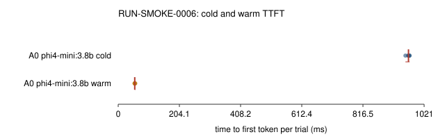
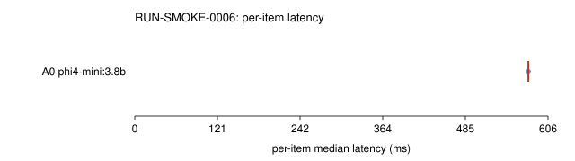

<!-- SPDX-License-Identifier: LicenseRef-TOKEN-NC-Research-1.0 -->
# Run report RUN-SMOKE-0006

**Label: EXPLORATORY.** Exploratory output; not a finding and not usable for confirmatory analysis.

## Provenance

- Experiment: SMOKE; run: RUN-SMOKE-0006; schema 1.0.0
- Config SHA-256: `144bbca302679a1120839a82ff544c4bba962e09dabf2c5df90496d6440ce67d`
- Protocol SHA-256: `None`
- Git revision: `57f6187e7b450fea05eedbbee8c663943596a699` (dirty: False)
- Backend: ollama (simulated: False), runtime version 0.9.6
- Items: `results/raw/arc/ARC-Challenge-validation.jsonl`, 1 items, SHA-256 `16b59737cb520f748020546b5e3fa76f0893d1a1237bb350dd81dd43a09f151b`
- Host: Apple M1 Pro, macOS-15.3.1-arm64-arm-64bit, power ac, load average at start [3.67, 2.39, 2.05]
- Start 2026-11-25T12:07:27Z, end 2026-11-25T12:07:35Z, runtime 7.199 s, 10 requests, 0 failures
- Harness peak RSS: 44.6 MiB

## Per-arm metrics

Accuracy: per-item mean over repetitions, then mean over items. Latency: per-item median over repetitions, then median [Q1, Q3] over items (ms).

| Arm | Model | n items | Acc. strict | Acc. lenient | Chance | Errors | Format fail strict | Format fail lenient |
|---|---|---|---|---|---|---|---|---|
| A0 | phi4-mini:3.8b | 1 | 0.000 | 1.000 | 0.250 | 0 | 10 | 0 |

| Arm | Latency median [Q1, Q3] (ms) | TTFT median (ms) | Decode (tok/s) | Prefill (tok/s) | Determinism | Peak RSS (MiB) | Max swap delta (MiB) |
|---|---|---|---|---|---|---|---|
| A0 | 577.37 [577.37, 577.37] | 507.73 | 56.9 | 1258.9 | 1.00 | 1220.7 | 0.0 |

## Spread between repetitions (seeds)

| Arm | Accuracy per repetition | Median latency per repetition (ms) | CV of repetition medians |
|---|---|---|---|
| A0 | 0.000 | 577.37 | n/a |

## Cold-start penalty (EXP-002 items 5, 6 and 16)

Penalty = median cold TTFT minus median warm TTFT (ms) over the valid trials of each arm. Percentile 95 % bootstrap CIs over trials (10,000 resamples, seed 7; cold and warm trials resampled independently). Load duration and end-to-end latency medians are descriptive.

| Arm | Model | Valid cold / warm | Invalid cold / warm | Cold TTFT median [95 % CI] (ms) | Warm TTFT median [95 % CI] (ms) | Penalty [95 % CI] (ms) |
|---|---|---|---|---|---|---|
| A0 | phi4-mini:3.8b | 5 / 5 | 0 / 0 | 968.4 [958.3, 972.0] | 55.1 [54.8, 57.1] | 913.3 [903.2, 916.9] |

| Arm | Cold load median (ms) | Warm load median (ms) | Cold latency median (ms) | Warm latency median (ms) |
|---|---|---|---|---|
| A0 | 807.2 | 29.7 | 1038.6 | 124.7 |

Ordering check by file size (A0 < A1 < A2): **not evaluable (an arm has no valid cold or warm trial)**. Reversal: None; adjacent CI overlap: None.

## Projection of planned matrices

Measured seconds per request in this run (block wall time including warm-ups): 0.7171.

| Planned experiment | Planned requests | Projected hours |
|---|---|---|
| EXP-001 | 4500 | 0.8964 |
| EXP-002 | 60 | 0.0120 |
| EXP-003 | 3000 | 0.5976 |

## Figure

