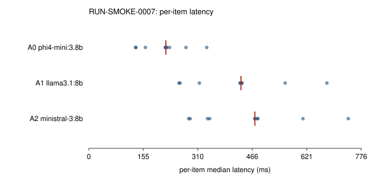

<!-- SPDX-License-Identifier: LicenseRef-TOKEN-NC-Research-1.0 -->
# Run report RUN-SMOKE-0007

**Label: EXPLORATORY.** Exploratory output; not a finding and not usable for confirmatory analysis.

## Provenance

- Experiment: SMOKE; run: RUN-SMOKE-0007; schema 1.0.0
- Config SHA-256: `c72c5e8ce6ca19a742f634f2cd52f7611b9afb21b19647fd119bf19288180e9d`
- Protocol SHA-256: `None`
- Git revision: `b4818bea868ba99ab182ca6a66b80aa73579688c` (dirty: False)
- Backend: ollama (simulated: False), runtime version 0.40.6
- Items: `results/raw/arc/ARC-Challenge-validation.jsonl`, 10 items, SHA-256 `16b59737cb520f748020546b5e3fa76f0893d1a1237bb350dd81dd43a09f151b`
- Host: Apple M1 Pro, macOS-15.3.1-arm64-arm-64bit, power ac, load average at start [2.8, 3.4, 3.07]
- Start 2026-11-26T12:24:51Z, end 2026-11-26T12:26:01Z, runtime 70.010 s, 60 requests, 0 failures
- Harness peak RSS: 43.6 MiB

## Per-arm metrics

Accuracy: per-item mean over repetitions, then mean over items. Latency: per-item median over repetitions, then median [Q1, Q3] over items (ms).

| Arm | Model | n items | Acc. strict | Acc. lenient | Chance | Errors | Format fail strict | Format fail lenient |
|---|---|---|---|---|---|---|---|---|
| A0 | phi4-mini:3.8b | 10 | 0.900 | 0.900 | 0.258 | 0 | 0 | 0 |
| A1 | llama3.1:8b | 10 | 0.900 | 0.900 | 0.258 | 0 | 0 | 0 |
| A2 | ministral-3:8b | 10 | 1.000 | 1.000 | 0.258 | 0 | 0 | 0 |

| Arm | Latency median [Q1, Q3] (ms) | TTFT median (ms) | Decode (tok/s) | Prefill (tok/s) | Determinism | Peak RSS (MiB) | Max swap delta (MiB) |
|---|---|---|---|---|---|---|---|
| A0 | 219.49 [175.41, 227.80] | 196.19 | 89.1 | 454.8 | 1.00 | 34.3 | 951.0 |
| A1 | 433.42 [343.74, 436.11] | 392.63 | 49.2 | 232.4 | 1.00 | 31.7 | 0.0 |
| A2 | 472.96 [339.65, 481.10] | 427.37 | 45.9 | 1510.0 | 1.00 | 34.3 | 1175.3 |

## Spread between repetitions (seeds)

| Arm | Accuracy per repetition | Median latency per repetition (ms) | CV of repetition medians |
|---|---|---|---|
| A0 | 0.900, 0.900 | 219.18, 219.92 | 0.002 |
| A1 | 0.900, 0.900 | 434.28, 433.63 | 0.001 |
| A2 | 1.000, 1.000 | 476.62, 472.62 | 0.006 |

## Paired contrasts against the baseline

Paired bootstrap over items (10,000 resamples, seed 7, percentile 95 % CI); exact McNemar; Holm within each extraction rule.

| Arm vs baseline | Extraction | n | Delta (pp) | 95 % CI (pp) | b | c | McNemar p | Holm p |
|---|---|---|---|---|---|---|---|---|
| A1 vs A0 | strict | 10 | 0.0 | [-30.0, 30.0] | 1 | 1 | 1 | 1 |
| A2 vs A0 | strict | 10 | 10.0 | [0.0, 30.0] | 1 | 0 | 1 | 1 |
| A1 vs A0 | lenient | 10 | 0.0 | [-30.0, 30.0] | 1 | 1 | 1 | 1 |
| A2 vs A0 | lenient | 10 | 10.0 | [0.0, 30.0] | 1 | 0 | 1 | 1 |

## Projection of planned matrices

Measured seconds per request in this run (block wall time including warm-ups): 1.0601.

| Planned experiment | Planned requests | Projected hours |
|---|---|---|
| EXP-001 | 4500 | 1.3251 |
| EXP-002 | 60 | 0.0177 |
| EXP-003 | 3000 | 0.8834 |

## Figure

